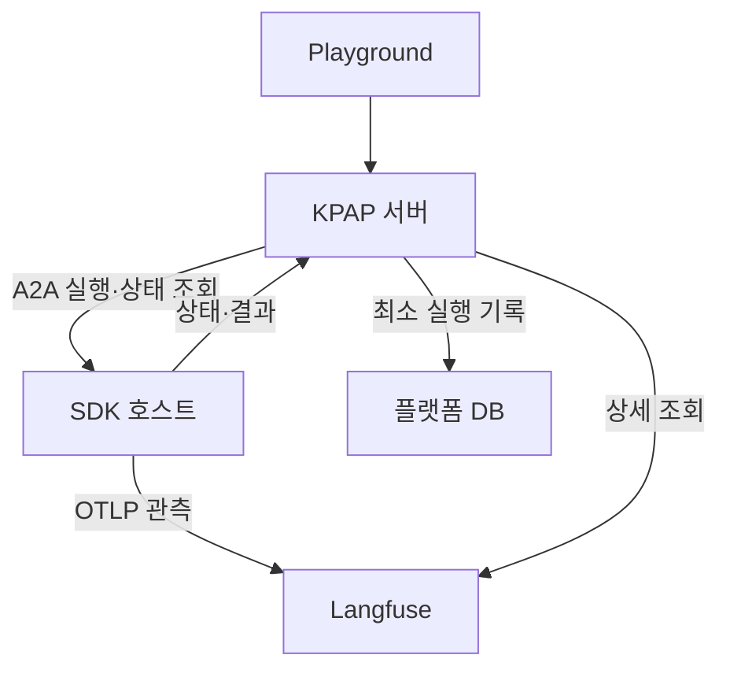

# Playground 원격 실행 · 관측 구현 스펙

검토용 v0.1 / 2026-10-20. 아래 인터페이스는 구현 제안이다. 실제 SDK·Langfuse 배포 통합 검증은 수행하지 않았다.

설계 원칙은 [Langfuse 연동](08-langfuse-v3-integration.md)을 따른다. A2A·GraphSpec은 [SDK endpoint 계약](11-sdk-endpoint-contracts.md)을 따른다.

## 1. 참고 아키텍처

| 구성 요소 | 구현 책임 |
|---|---|
| KPAP 실행 서비스 | run 생성, A2A 호출, 상태 갱신 |
| KPAP 관측 어댑터 | Langfuse 조회, 버전별 응답 변환, 권한 확인 |
| SDK 호스트 어댑터 | A2A·인증·binding 검증, 응답 직렬화 |
| SDK 코어 | 요청별 설정, 실행 문맥, 노드·모델·도구 계측 |
| SDK exporter | 관측 비동기 전송, 제한된 버퍼·재시도 |
| 기존 플랫폼 DB | 실행 요약과 기존 설정·등록 정보 |
| Langfuse | 상세 입력·출력·관측·사용량·비용 |

별도 실행 엔진이나 관측 복제 DB를 플랫폼에 추가하지 않는다. SDK 코어는 HTTP 프레임워크와 분리한다.

## 2. 실행 흐름

1. KPAP가 권한을 확인하고 runId와 traceId를 생성한다. traceId는 32자리 소문자 16진수의 유효한 OTel ID로 생성한다.
2. KPAP가 최소 실행 레코드를 저장한다. 초기 status는 queued다.
3. KPAP가 A2A 요청에 설정 변경값과 검증 가능한 runtime binding을 전달한다.
4. SDK가 binding과 설정을 검증한다. 실제 적용 설정을 기존 스냅샷 계약으로 확정한다.
5. SDK가 전달받은 traceId로 실행 문맥을 열고 에이전트를 실행한다.
6. SDK가 A2A로 상태·결과·식별자를 반환한다. 관측은 Langfuse로 비동기 전송한다.
7. KPAP가 A2A 응답으로 실행 레코드를 갱신한다.
8. 사용자가 상세를 열면 KPAP가 저장된 traceId로 Langfuse를 조회한다.

traceId를 미리 저장하므로 최종 응답을 받지 못해도 관측 조회 연결은 유지된다. traceId만으로 실행 성공이나 관측 도착을 보장하지 않는다.

### Runtime binding 제안

플랫폼→SDK 내부 호출의 전용 헤더 `KPAP-Runtime-Binding`에 서명된 토큰을 전달한다. A2A 표준 필드가 아닌 KPAP 내부 계약이다.

| 토큰 claim | 의미 |
|---|---|
| runId · sessionId · traceId | 플랫폼이 발급한 실행 연결 |
| projectId · agentId | 허용된 프로젝트와 실행 대상 |
| iss · aud · exp | 발급자, SDK 호스트 수신자, 유효기간 |

SDK는 서명·만료·대상·인증 주체의 권한을 검증한다. 브라우저가 지정한 ID를 그대로 신뢰하지 않는다. 토큰에는 입력·설정 원문·비밀값을 넣지 않는다. 서명 알고리즘·키 배포 방식은 사내 서비스 인증 체계에 맞춰 확정한다.

응답의 `metadata.kpap`에는 기존 runId·snapshotId·graphVersion·applied와 함께 traceId를 반환한다. 플랫폼은 요청과 응답의 runId·traceId 일치를 확인한다.

task 추가 입력은 기존 runId·traceId·스냅샷을 유지한다. SDK는 task에 연결 정보를 보존한다. 만료된 토큰은 플랫폼이 새로 발급한다. 새 업무 실행은 새 runId·traceId를 사용한다.

binding은 멱등키가 아니다. 응답 유실 시 자동 재실행하지 않는다. taskId가 있으면 상태를 조회한다. 없으면 remoteState=unknown으로 표시한다.

## 3. SDK 필수 스펙

| 영역 | 필수 동작 |
|---|---|
| 요청 격리 | 설정·세션·trace 문맥을 요청별로 유지. 공유 graph 설정 변경 금지 |
| 계측 시작 | binding의 traceId를 사용. SDK 내부에서 별도 trace를 중복 생성하지 않음 |
| 노드 계측 | 노드 시작·종료·오류와 안정적인 nodeId 기록 |
| 반복·재시도 | invocationId로 노드 수행 구분. 재시도에는 logicalCallId·attemptId 추가 |
| 하위 호출 | 모델·도구·검색 관측을 실행 노드 아래에 연결 |
| 비동기 실행 | coroutine·스레드·하위 서비스로 trace 문맥 전달 |
| 설정 확인 | 실제 적용 snapshotId·graphVersion·codeVersion 기록 |
| 전송 | 업무 응답과 분리. 버퍼·타임아웃·재시도 상한 설정 |
| 종료 | 정상 종료 시 제한 시간 내 flush. 강제 종료 시 유실 가능 |
| 데이터 처리 | 전송 전에 입력·출력 마스킹. 비밀키·인증 헤더 기록 금지 |

Python/LangGraph는 Langfuse CallbackHandler를 실행 문맥 안에 연결한다. KPAP 노드 계측과 콜백의 중복 span을 피한다. Java는 OTel API·SDK·OTLP HTTP exporter와 KPAP 속성 어댑터로 구성한다. Spring 의존성은 필수가 아니다.

### 관측 데이터 계약

다음은 KPAP 논리 필드다. SDK 어댑터가 Langfuse 또는 OTel 속성으로 변환한다.

| 관측 범위 | 기록할 필드 |
|---|---|
| 모든 관측 | traceId, observationId, parentObservationId, 시작·종료 시각, 오류 여부 |
| 공통 문맥 | sessionId, runId, agentId, snapshotId, graphVersion, codeVersion |
| 노드 | nodeId, invocationId |
| 모델·도구·검색 | 종류, 자원 식별자, 허용된 입력·출력 |
| 모델 | 실제 모델명, 반환된 token usage, 확인 가능한 비용 |
| 재시도 | logicalCallId, attemptId |

관측 ID와 부모 ID는 OTel span ID로 연결한다. 공통 문맥은 하위 관측에도 전파한다. KPAP 전용 필드는 metadata에 보존한다. usage·비용을 알 수 없으면 null로 반환한다.

GraphSpec은 가능한 경로를 제공한다. 실제 실행 표시는 nodeId·invocationId로 연결한다. 정확한 분기선 표시가 필요하면 predecessorInvocationIds 등 전이 정보를 별도 기록한다. 단순 span 부모 관계를 그래프 연결선으로 해석하지 않는다.

## 4. Langfuse 호환 범위

2026-10-20 공식 호환표 기준이다. 실제 서버 릴리스와 SDK 패치 버전은 배포 환경에서 고정한다.

| 항목 | self-hosted v3 기준 | v4 전환 시 |
|---|---|---|
| Python 송신 | 서버 ≥3.63.0 + Langfuse Python SDK v4 | 호환 범위 확인 후 유지 또는 업그레이드 |
| Java 송신 | 서버 ≥3.22.0의 OTel 수집 지원. 본 설계 기준선은 ≥3.63.0 | OTel 속성·수집 모드 재검증 |
| 선택적 JS/TS 송신 | 서버 ≥3.63.0 + JS/TS SDK v5 | 호환 범위 확인 후 변경 |
| Python v5 · JS/TS v6 | 미지원 | 서버 ≥4.59.0 필요 |
| 상세 조회 | legacy traces·observations·sessions API | Observations API v2 기반으로 교체 |
| Observations·Metrics API v2 | 미지원 | 지원 |
| 최신 문서의 예제 | v3 호환 여부 확인 후 적용 | 배포 모드와 대조 |

OTLP traces endpoint는 `/api/public/otel/v1/traces`다. HTTP/protobuf를 기준으로 사용한다. Langfuse endpoint에 gRPC로 직접 보내지 않는다. 프로젝트 API 키는 서버 측 secret으로 관리한다.

v3 조회는 아래 REST API를 관측 어댑터에 격리한다.

| 목적 | API 후보 |
|---|---|
| 실행 상세 | GET /api/public/traces/{traceId} |
| 관측 목록 | GET /api/public/observations |
| 관측 상세 | GET /api/public/observations/{observationId} |
| 세션 상세—선택 | GET /api/public/sessions/{sessionId} |

실행 목록은 플랫폼 DB에서 조회하므로 Langfuse 세션 목록 API는 필수가 아니다. 관측 필터·페이지·응답 필드는 배포 서버 OpenAPI로 확인한다. Langfuse 내부 DB나 UI 전용 API는 사용하지 않는다.

Python SDK v4의 기본 조회 API가 v3 서버와 호환된다고 가정하지 않는다. 조회는 위 REST 어댑터를 사용하거나 배포 버전에 맞는 legacy 클라이언트를 사용한다.

## 5. 플랫폼 저장 범위

### 실행 레코드

| 필드 | 필수 | 저장 규칙 |
|---|---|---|
| runId | 예 | PK |
| sessionId | 예 | 기존 세션 FK. 세션에서 프로젝트·권한 범위를 확인 |
| agentId | 예 | 등록된 실행 대상 FK |
| traceId | 예 | 호출 전에 생성. 업무 재실행 시 새 값 |
| status | 예 | 공통 실행 상태. A2A로 갱신 |
| remoteState | 조건부 | 결과를 확인할 수 없으면 unknown |
| createdAt | 예 | 실행 접수 시각 |
| startedAt · endedAt | 조건부 | 확인된 시각만 저장. 모르면 null |
| taskId · contextId | 조건부 | 호스트가 반환한 값만 저장 |
| snapshotId | 조건부 | SDK 적용 확인 후 기존 불변 스냅샷 참조 |
| telemetryTargetId | 조건부 | 기존 등록 정보로 과거 Langfuse 대상을 고정할 수 없을 때만 저장 |

권장 인덱스는 `(sessionId, createdAt, runId)`다. traceId에 고유 제약을 둔다. Langfuse 대상 매핑은 과거 실행 조회가 유지되도록 불변 등록 버전을 참조하거나 telemetryTargetId로 고정한다.

### 기존 저장소 재사용

| 데이터 | 저장 위치·범위 |
|---|---|
| 프로젝트·세션·권한 | 기존 플랫폼 정보 재사용 |
| 호스트·GraphSpec | 기존 에이전트 등록. 과거 스냅샷이 참조하는 버전 보존 |
| 적용 설정·자원 버전 | 기존 불변 스냅샷. run에는 snapshotId만 저장 |
| Langfuse URL·프로젝트·키 참조 | 연동 설정. 키 원문은 secret 저장소 |
| SDK task·체크포인트 | SDK 호스트. Playground DB로 복제하지 않음 |

설정 스냅샷에 필요한 프롬프트 설정 또는 불변 버전 참조는 유지한다. Langfuse의 실제 렌더링된 프롬프트·실행 입출력은 플랫폼에 복제하지 않는다.

### 플랫폼에 저장하지 않는 데이터

노드별 span, 토큰 스트림, 상세 입력·출력, 검색 결과 원문, stack trace, token usage·비용 집계는 Langfuse에서 조회한다. 관측 수집 상태는 조회 응답으로만 제공한다.

이 최소 저장안에서는 Langfuse 장애·삭제 시 과거 답변 원문도 조회할 수 없다. 과거 답변을 독립적으로 보존해야 하는 요구가 생기면 별도 업무 저장 범위로 합의한다.

## 6. Playground 조회 계약

아래는 KPAP API 제안이다. SDK 호스트의 A2A endpoint와 구분한다.

| endpoint | 처리 |
|---|---|
| GET /api/v1/agents/{agentId}/runs?sessionId=… | DB 실행 목록. cursor·limit 적용 |
| GET /api/v1/agents/{agentId}/runs/{runId} | 실행 요약·task·snapshot 참조 |
| GET /api/v1/agents/{agentId}/runs/{runId}/trace | 권한 확인 후 Langfuse 관측 조회 |

trace 응답은 `availability`, `observations`, `nextCursor`로 정규화한다. observation에는 id·parentId·nodeId·invocationId·type·시간·오류·허용된 입출력·usage·cost를 제공한다. 없는 값은 null이다. 페이지 커서는 버전별 어댑터가 변환한다.

| 상황 | 플랫폼 응답 |
|---|---|
| 관측 조회 성공 | 200, availability=available. 전체 수집 완료를 뜻하지 않음 |
| 플랫폼 run은 있으나 trace 미조회 | 200, availability=not_found. 수집 전·삭제 여부는 단정하지 않음 |
| Langfuse 장애·인증 설정 오류 | 502/503, 구조화된 오류. 빈 성공 응답으로 바꾸지 않음 |
| 사용자 권한 없음 | 403. Langfuse 조회 수행 안 함 |

관측 조회 상태는 DB에 저장하지 않는다. 화면은 실행 상태를 유지한 채 상세 조회만 재시도한다. 캐시는 프로젝트 권한 범위·run·페이지별로 격리한다.

## 7. 구현 완료 기준

- 고정한 서버·SDK 조합에서 Python 및 Java의 같은 논리 필드가 조회된다.
- 동시 실행에서 설정·세션·trace가 섞이지 않는다.
- 반복·병렬·재시도 관측이 올바른 노드에 연결된다.
- A2A 성공 후 Langfuse 조회 지연을 업무 실패로 표시하지 않는다.
- SDK 응답 유실 시 저장된 traceId가 유지된다. 자동 중복 실행하지 않는다.
- 페이지 조회와 권한 격리를 확인한다. 플랫폼 DB에 상세 관측이 저장되지 않는다.

출시 전 확정 항목: 배포 릴리스·SDK 패치 버전, binding 서명·키 배포, 실제 스냅샷 등록 경로. 해당 항목은 현재 구현 완료로 간주하지 않는다.

## 공식 근거

- [Langfuse 서버·SDK·API 호환표](https://langfuse.com/self-hosting/upgrade/versioning)
- [OpenTelemetry 수집과 속성 매핑](https://langfuse.com/integrations/native/opentelemetry)
- [LangGraph 연동](https://langfuse.com/integrations/frameworks/langgraph)
- [Trace ID와 분산 추적](https://langfuse.com/docs/observability/features/trace-ids-and-distributed-tracing)
- [v3 비동기 수집](https://langfuse.com/self-hosting/upgrade/upgrade-guides/upgrade-v2-to-v3)
