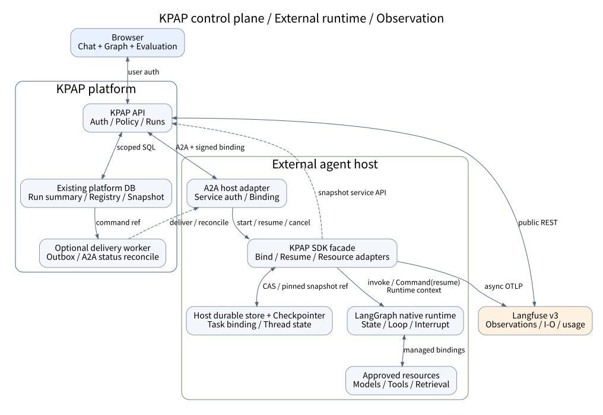
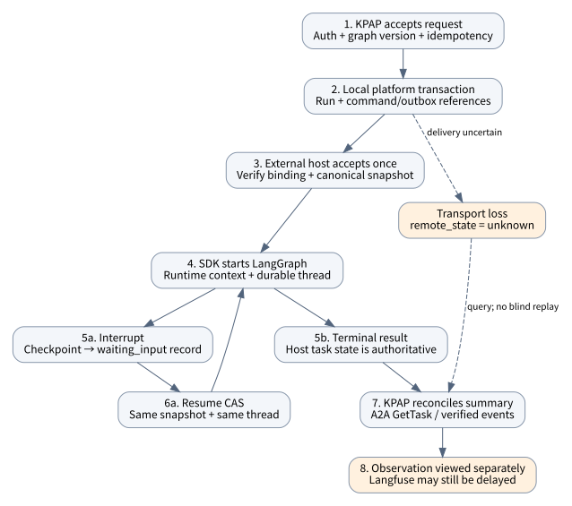

# KPAP와 LangGraph 실행 아키텍처 및 연동 명세

설계 제안 v0.3 · 2026년 10월 25일 · 대상: 플랫폼·SDK·에이전트 구현팀

> 검증 범위: 문서·예시의 정적 검토다. SQL은 실행하지 않았다. Agent Server는 미채택 대안이며 운영 동작을 보증하지 않는다.

## 1. 권고안과 설계 범위

**LangGraph를 실행 엔진으로 유지하고, KPAP SDK는 승인된 리소스의 요청별 바인딩과 플랫폼 연동만 담당한다.** 그래프 실행·checkpoint·interrupt·병렬 분기를 SDK에서 다시 만들지 않는다. 플랫폼은 실행을 요청하고 요약 상태를 관리하지만 외부 런타임을 대신 실행하지 않는다.

현재 CSE-Summary의 00·01·03·11·12 및 그래프 규약은 불변 설정, 외부 SDK 호스트, 최소 플랫폼 저장, Langfuse 상세 관측이라는 방향을 갖는다. 이 문서는 그 방향을 유지하면서 **제안 SDK 인터페이스와 실패 복구 계약을 구체화**한다. API 이름, 추가 헤더·확장, 테이블과 SQL은 구현 제안이지 실제 배포 시스템의 증명이 아니다. 검토 기준은 저장소 commit 17d6b41이며 운영 배포·인증·DB·SDK 통합 검증은 별도로 필요하다.

### 권고 순서

1. SDK 관리형 모델·도구·검색 노드와 per-node snapshot을 먼저 고정한다.
2. 기존 런타임이 LangGraph OSS인지 Agent Server인지 선택하고 실행 인프라를 중복 구축하지 않는다.
3. 초기 실행·실제 적용 확인·GetTask 상태 조회를 먼저 통합한다.
4. durable resume/CAS·멱등 전달·취소·복구는 지원 capability와 저장 계약을 갖춘 뒤 활성화한다.

SDK가 추가로 필요한 이유는 LangGraph가 부족해서가 아니다. **기업 공통 자원 정책, 그래프 UI의 editable 계약, 여러 팀·언어의 실행 식별자와 적용 근거를 동일하게 만들기 위해서**다. 단일 팀이 Python 코드만 직접 운영하고 중앙 편집·권한·평가 연계가 필요 없다면 얇은 LangGraph 실행 코드와 관측 계측만으로도 충분하다.

## 2. LangGraph native와의 차이 및 한계

### 2.1 세 계층을 혼동하지 않는다

| 기능 | LangGraph OSS library | LangGraph Agent Server | KPAP 추가 책임 |
|---|---|---|---|
| 그래프·분기·루프·reducer | native | native runtime 사용 | 등록 정보를 UI와 연결 |
| Runtime context | native | 실행 설정/컨텍스트 전달 | 노드별 승인 revision으로 불변 바인딩 |
| checkpoint·interrupt | native 기능과 checkpointer | 서버 persistence·runs/threads 제공 | snapshot/권한/코드 버전과 복원 일치 검증 |
| 실행 API·queue·worker | 호스트 구현 | 서버 기능 제공 | 기존 서버 API에 어댑터 연결 |
| A2A | library 자체 HTTP 서버 아님 | 공식 문서상 A2A endpoint 제공 | graph-config·runtime binding·정책 확장 |
| 모델·도구 사용 | Python node가 자유롭게 구현 | 동일한 자유도 | 허용 자원·동일 tool schema/dispatcher |
| 프롬프트·지식 변경 | 개발자가 context를 소비해야 함 | 설정 경로에 따라 가능 | editable·버전·권한·snapshot 계약 |
| 상세 관측 | 계측 연동 가능 | 서버 trace 연동 가능 | 현재 온프렘 Langfuse 대상으로 정규화 |

LangGraph native는 StateGraph, Runtime context, checkpoint, interrupt, streaming, subgraph를 이미 제공한다. SDK는 이를 감싼 adapter이며 새로운 그래프 스케줄러가 아니다. [S1][S2][S3]

Agent Server는 별도 제품 계층으로 runs/threads/assistants·실행 queue·persistence API를 제공한다. 이를 사용하면 이 문서의 Host RunStore/ExecutionDriver를 그대로 새로 만들지 말고 서버의 식별자·상태·취소·재개 API에 매핑한다. 공식 A2A 문서에는 `/a2a/{assistant_id}`, SendMessage·SendStreamingMessage·GetTask·CancelTask와 기존 task를 통한 interrupt 재개가 있으며 **SubscribeToTask와 push는 미지원**으로 기술된다. 배포한 release의 실제 동작을 확인해야 한다. [S4][S5]

### 2.2 SDK 관리형 경로의 이익과 비용

관리형 노드는 모델 핸들 생성, 단일 system-template 렌더링, 검색 호출, 도구 schema/실행 허용 집합을 SDK로 이동시킨다. 에이전트는 state 변환과 연결·업무 분기를 유지한다. 이때 request-time 변경은 명시적 슬롯에만 적용되므로 UI의 변경 의미가 분명해진다.

대신 native Python의 모든 자유도를 포괄하지는 못한다. closure 안의 모델, 직접 API 호출, middleware가 추가하는 프롬프트, 도구 내부 retriever, 동적 subagent는 별도 등록·어댑터가 없으면 제어되지 않는다. custom 노드는 실행·계측은 유지하되 설정 편집은 읽기 전용으로 표시한다. SDK wrapper는 임의 Python의 우회 호출을 차단하는 sandbox가 아니다.

provider가 immutable model version pin을 제공하지 않거나 외부 도구·검색 데이터가 변하면 같은 snapshot도 동일 출력을 보장하지 않는다. snapshot은 확정한 설정과 확인 가능한 revision의 기록이지 모델 가중치·외부 세계의 복제본이 아니다.

모델별 tool-calling·structured output·streaming 능력이 다르므로 모델 alias만 바꾼다고 호환성이 보장되지 않는다. 시작 전 capability 검사와 명시적인 거부가 필요하다. 도구 schema를 숨기는 것과 도구 실행 권한을 거부하는 것도 별개다. 모델 노출과 dispatcher는 같은 고정 tool bindings를 사용하고 실제 호출 시 권한을 다시 검사한다. [S6]

### 2.3 확장성 판단

| 확장 | 권장 방식 | 비용·한계 |
|---|---|---|
| 여러 LLM 노드 | nodeId별 model/prompt/tools 바인딩 | 전역 NodeConfig 사용 금지 |
| 여러 지식 자원 | retrieval 노드 분리, 이후 typed multi-resource 계약 | 기존 단일 knowledge 객체를 암묵 확장하지 않음 |
| 모델 provider | ModelAdapter + capability matrix | schema 변환·usage·stream·오류 매핑 테스트 필요 |
| 도구/MCP | 승인 registry resolver + ToolExecutor | 런타임 발견 schema/revision·권한 검증, 임의 URL 금지 |
| prompt registry | 불변 prompt version을 본문으로 해석 | phase/latest는 시작에 고정; 호출별 렌더 결과 별도 |
| subgraph | namespace를 포함한 안정적 공개 nodeId | 부모/자식 ID·checkpoint 경계 매핑 필요 |
| 동적 subagent | capability 등록된 하위 실행에 별도 binding | 부모 설정이 자동 상속된다고 가정하지 않음 |
| native custom | 읽기 전용 escape hatch | 내부 호출의 config 적용 보장 제외 |
| Java 에이전트 | 공통 wire·binding·관측 계약 + 별도 runtime adapter | Python LangGraph 실행기를 Java에 강제하지 않음 |

Agent Server의 graph factory를 사용하는 경우에도 설정 때문에 매번 topology를 바꾸는 설계는 피한다. 공식 문서는 노드 안에서 설정을 읽는 방식을 권장하며 factory가 조회·introspection에도 사용될 수 있음을 설명한다. SDK는 등록·코드 버전으로 구조를 고정하고 요청 context로 값만 바꾸는 것을 기본으로 한다. [S7]

## 3. 전체 아키텍처와 신뢰 경계



그림 1. 실선은 요청/상태 흐름, 점선은 선택적 전달 worker 또는 기존 snapshot 서비스 연동이다. 외부 호스트가 플랫폼 DB에 직접 SQL로 접근하지 않는다.

### 3.1 역할과 원본 저장소

| 데이터·책임 | 원본 | 다른 계층에 보관할 것 |
|---|---|---|
| 사용자·프로젝트·세션 권한 | 기존 KPAP | 호스트에는 검증된 서비스 권한 문맥 |
| GraphSpec·등록 버전 | 기존 등록 저장소/호스트 등록 정의 | 플랫폼은 실행이 참조한 불변 등록 버전 |
| 확정 설정 snapshot | 기존 KPAP 불변 설정 저장소 | 호스트는 snapshot ID/hash와 검증된 복원 cache |
| 업무 실행 task 상태 | 외부 호스트 실행 상태 | 플랫폼은 조회용 상태 projection |
| LangGraph state/checkpoint | 호스트 checkpointer | 플랫폼에는 checkpoint 원문 복제 금지 |
| trace 상세·입출력·usage | Langfuse | 플랫폼에는 trace ID와 대상 등록 참조 |
| 전달/복구 command | 선택적 플랫폼 outbox | 상세 관측 DB로 확대하지 않음 |

SDK의 SnapshotStore SPI는 **기존 KPAP snapshot 서비스의 adapter**로 구현하는 것이 기본이다. 호스트가 같은 ID의 설정을 별도로 수정하는 두 번째 원본이 되면 안 된다. 복원 cache를 둘 경우 digest를 검증하고, 보존/권한/암호화 정책을 정한다.

### 3.2 세 가지 인증은 다르다

- Browser→KPAP: 사용자 인증과 프로젝트/세션 접근 권한.
- KPAP→Host: 등록된 서비스 credential 또는 조직 mTLS/OAuth 정책, A2A 버전·확장, signed runtime binding 검증.
- SDK→Resources/Langfuse: server-side secret resolver·각 서비스 권한. 브라우저와 snapshot에 비밀 원문을 넣지 않는다.

서버는 등록된 origin/허용 경로만 호출하며 임의 graphUrl·redirect를 따라 내부망에 접근하지 않는다. GraphSpec enum은 UI 선택 제한일 뿐 실제 자원 권한 검사를 대체하지 않는다.

## 4. SDK와 전송 계약

### 4.1 공개 SDK 표면

```python
sdk.register(AgentDefinition(...)) -> AgentDescriptor
await sdk.start(StartRequest(...), auth=verified_auth,
                binding=verified_binding) -> RunView
await sdk.get(run_id, auth=verified_auth) -> RunView
await sdk.resume(ResumeRequest(...), auth=verified_auth) -> RunView
await sdk.cancel(CancelRequest(...), auth=verified_auth) -> CancelReceipt
```

register/start/get는 기본이다. resume/cancel/stream은 runtime adapter가 지원하는 capability만 선언한다. 이 문서의 기본 OSS 호스트 경로에서는 SDK가 compiled graph를 내부에 보관하고 `Runtime.context`로 노드별 bindings를 제공한다. Host와 에이전트가 공개 실행 요청에서 graph.invoke를 직접 호출하지 않는다. Agent Server 경로에서는 server가 compile·실행 수명주기를 소유하며 SDK ExecutionDriver가 server API로 위임한다. 같은 SDK가 별도 graph worker를 동시에 운영하지 않는다.

에이전트는 NodeSpec과 `ManagedNodes.rag/llm/tools/custom`으로 그래프를 조립한다. read/write callback은 state 변환만 담당하며 부작용을 넣지 않는다. `new_graph(State)`는 SDKRuntimeContext schema를 설정하고 build는 uncompiled graph를 반환한다. model/prompt/tools/knowledge를 하나의 전역 config로 병합하지 않고 `bindings[node_id]`로 보관한다.

### 4.2 HTTP 계층

| 경로·메서드 | 분류 | 의미 |
|---|---|---|
| GET /.well-known/agent-card.json | A2A 발견 | 실제 실행 interface와 capability |
| GET /agents/{agentId}/graph | 기존 KPAP 초안 | GraphSpec, ETag, 공개 설정 |
| POST Card의 JSONRPC URL | A2A 1.0 | SendMessage/GetTask 등 |
| POST /api/v1/agents/{id}/runs | KPAP 설계 | UI 실행 접수 |
| POST /api/v1/agents/{id}/runs/{runId}/resume | 신규 KPAP 제안 | expected host revision 포함 재개 요청 |
| POST /api/v1/agents/{id}/runs/{runId}/cancel | 신규 KPAP 제안 | 취소 의도 접수 |
| GET /api/v1/agents/{id}/runs/{runId}/trace | 기존 KPAP 초안 | 권한 검사 후 Langfuse 조회 |
| GET /kpap/v1/executions/by-run/{runId} | 선택적 host 확장 제안 | taskId 유실 시 조정용 run 조회 |

GraphSpec의 configSchema 제한 부분집합과 wire 검증용 JSON Schema를 구분한다. 지원하지 않는 버전/필드는 조용히 무시하지 않는다. 새 endpoint·확장은 Agent Card/등록 capability에 선언하고 상대가 지원할 때만 사용한다.

### 4.3 초기 A2A 요청

```http
POST {registered-jsonrpc-url}
Authorization: Bearer <service-credential>
Content-Type: application/json
A2A-Version: 1.0
A2A-Extensions: urn:kpap:graph-config:1
KPAP-Runtime-Binding: <signed-token>
```

```json
{
  "jsonrpc": "2.0", "id": "rpc-1", "method": "SendMessage",
  "params": {
    "message": {
      "messageId": "msg-1", "role": "ROLE_USER",
      "parts": [{"text": "반품 정책을 알려주세요."}]
    },
    "configuration": {"returnImmediately": true},
    "metadata": {"kpap": {
      "contractVersion": "1.0", "graphVersion": "v2",
      "overrides": [
        {"nodeId": "retrieve", "config": {"knowledge": {
          "resourceId": "policy", "version": "v1", "topK": 5
        }}},
        {"nodeId": "answer", "config": {
          "model": "reasoning", "tools": [],
          "prompt": "근거와 함께 답하세요."
        }}
      ]
    }}
  }
}
```

`returnImmediately:true`는 background task 접수 경로에 사용한다. 즉시 완료 가능한 경우 Message가 반환될 수도 있으므로 Task만 가정하지 않는다. SendMessage 결과는 `result.task` 또는 `result.message`다. RPC id는 요청/응답 연결 값이며 실행 멱등키가 아니다. [S8]

기존 runtime binding 초안의 claim은 runId/sessionId/traceId/projectId/agentId/iss/aud/exp다. SDK는 서명·대상·만료·인증 주체와 등록 scope를 검증한다. 이번 설계는 운영 강화를 위해 operation scope·request digest·발급 ID를 추가하는 안을 제안한다. 이 추가 claim은 기존 구현 필드라고 간주하지 않는다. binding 자체는 멱등키가 아니다.

### 4.4 재개와 전달 멱등성의 추가 계약

A2A에는 LangGraph 전용 ResumeTask나 checkpoint CAS가 없다. 기본 추가 입력은 기존 taskId/contextId를 지정한 SendMessage이며, 안전한 SDK.resume 매핑은 별도 확장이 필요하다.

제안 확장 `urn:kpap:execution-control:1`은 graph-config와 별도로 선언·활성화한다. 요청 metadata의 `kpapControl`에 다음을 사용한다.

```json
{
  "operationId": "resume-operation-7",
  "operation": "resume",
  "expectedTaskRevision": 12,
  "resumeValues": {"interrupt-abc": {"approved": true}}
}
```

추가 입력의 `message.taskId/contextId`는 기존 값을 쓰고 새 messageId를 발급한다. 설정 overrides는 보내지 않는다. host는 명시된 interrupt와 task revision을 확인한 뒤 SDK.resume로 변환한다. 응답 Task metadata에는 `taskRevision`과 공개 가능한 pending interrupt 식별자를 제공한다. 이것은 KPAP 확장이지 A2A 일반 규격이 아니다. resumeValues가 재개 입력의 원본이며 message.text는 설명용이다. 둘을 독립 업무 입력으로 해석하지 않는다. 확장 지원·활성화가 없으면 요청을 거부하고 기본 실행으로 대체하지 않는다.

초기 실행의 operation=start와 operationId, 취소의 operation=cancel에도 같은 중복 방지 계약을 쓸 수 있다. host는 operationId+payload digest를 영속 저장하고 같은 명령의 결과를 반환한다. **상대가 이 계약을 지원하지 않으면 응답 유실 후 자동 재전송하지 않는다.** A2A messageId 중복 처리는 보편적인 exactly-once 보장이 아니다.

## 5. 초기 실행의 계층별 호출 순서



그림 2. 실행 상태와 관측 도착은 별도 흐름이다. 응답 유실은 실패 확정이 아니라 원격 상태 불명이다.

### 5.1 발견과 편집

1. Browser가 KPAP GET graph를 호출한다. KPAP는 사용자·프로젝트·agent 접근 권한을 확인한다.
2. 등록된 Card에서 JSONRPC 1.0 interface와 확장·graphUrl을 확인한다. cache는 호출 주체·프로젝트·환경·agent별로 격리한다.
3. KPAP가 호스트 GraphSpec을 조건부 GET한다. ETag는 표현 cache, graphVersion은 실행 호환성이다.
4. UI는 editable 슬롯만 편집한다. 저장되지 않은 초안은 기존 실행 snapshot을 바꾸지 않는다.

### 5.2 접수와 실행

| 순서 | API/HTTP | DB 또는 내부 동작 |
|---|---|---|
| 1 | Browser POST runs + Idempotency-Key | 사용자/세션/agent ownership 검증 |
| 2 | KPAP 자원 해석 서비스 | 기본값+허용 override, 실제 revision candidate 고정 |
| 3 | KPAP 로컬 transaction | runId/traceId 선할당, run summary, 선택적 outbox 기록 |
| 4 | KPAP→Host SendMessage | 서비스 인증+signed binding+graph config |
| 5 | Host→SDK.start | run/operation 중복·graph version·권한 재검증 |
| 6 | SDK→기존 snapshot service | resolved values 비교·불변 snapshot 등록/조회 |
| 7 | Host 로컬 transaction | task/run/snapshot/thread 연결 저장, 실행 인계 |
| 8 | SDK→LangGraph | snapshot으로 Runtime context 구성, graph 실행 |
| 9 | 관리형 node→Resources | 노드별 모델·prompt·tools·knowledge 적용 |
| 10 | Host→KPAP Task/Message | run/trace 일치 확인, snapshot·task 상태 projection |
| 11 | SDK→Langfuse | 비동기 관측 송신; 업무 응답과 분리 |

플랫폼 사전 해석은 candidate이며, SDK가 같은 버전과 실제 적용값을 확인한 뒤 canonical snapshot을 참조한다. revision이 달라지면 조용히 대체하지 않는다. snapshot 등록과 host run 저장은 분산 transaction이 아니다. 시작 전 snapshot은 생성되었으나 host 실행이 실패할 수 있고, 이때 snapshot은 미사용 참조로 정리한다. 유효 snapshot 확인 전 업무 부작용을 시작하지 않는다.

기존 내부 `/api/v1/runtime/runs/{id}/events` 계약을 사용할 경우 설정 적용 확인·업무 상태 보고를 분리한다. 상세 모델/도구 입출력은 이 event API에 복제하지 않는다. 실제 snapshot 등록 endpoint의 세부사항은 기존 설정 서비스 API와 합의해야 한다.

### 5.3 durable 전달은 선택적 확장

최소안은 run을 먼저 저장하고 동기 HTTP로 전달한다. 서버가 중간에 죽으면 queued/unknown run을 남기고 운영 조정한다. durable 전달이 필요하면 platform outbox를 추가하되 이것은 **A2A command 전달 queue이지 그래프 node scheduler가 아니다.**

outbox에 입력 hash만 저장하면 재전송할 원문이 없어 복구할 수 없다. 기존 업무 입력 저장소의 immutable reference를 사용하거나, 별도 합의한 암호화·TTL dispatch envelope를 추가한다. 후자는 최소 저장안의 명시적 확장이며 완료 후 삭제하고 장기 관측 원본으로 쓰지 않는다. baseline에서는 Langfuse 상세 입력·출력을 플랫폼에 저장하지 않는다.

## 6. PostgreSQL 예시와 transaction 경계

이 절은 PostgreSQL용 **의사 스키마와 파라미터화 SQL 예시**다. 실제 운영 테이블 이름·DDL·권한 모델·마이그레이션을 확인한 결과가 아니다. `p_`는 플랫폼, `h_`는 호스트 저장소를 의미하며 서로 다른 DB일 수 있다. 아래 statement들은 각 번호의 로컬 transaction에서만 원자적이다.

### 6.1 최소 레코드와 선택적 확장

| 제안 레코드 | 핵심 필드 | 범위 |
|---|---|---|
| p_runs | tenant/project/session/agent, run/trace, status, task/context, snapshot ref | 기존 실행 요약 확장 |
| p_runs projection 필드 | revision, host_revision, remote_state, cancel_requested | 순서·불명·취소 의도 구분 |
| p_commands | operation ID, run, kind, request hash/key, 선택적 payload_ref | 멱등 접수 보장에 필요한 작은 ledger |
| p_outbox | command ID, available_at, lease_token/until, state | 선택적 전송 queue |
| h_runs | platform_run, host task/context, snapshot ID/hash, graph/code, thread/namespace/checkpoint | host 실행 원본 |
| h_operations | operation ID, payload hash, 결과 참조 | 협상한 command dedupe |
| h_runs 실행 제어 | revision, lease_epoch, lease_until, pending interrupt IDs | durable resume/중복 worker 제어 |

Idempotency-Key를 보장하려면 p_commands 같은 durable key/hash ledger 또는 p_runs의 동등한 unique admission 필드가 필요하다. ledger 메타데이터는 필수이고, outbox와 복구용 입력 payload 저장만 선택적이다. 아래는 ledger를 분리한 제안이다.

상세 span·토큰 stream·검색 결과·입출력은 p_runs에 넣지 않는다. h_runs도 상세 관측 저장소가 아니라 task/checkpoint 연결과 복구 control record다. canonical snapshot 원문은 기존 설정 저장소에서 유지한다.

제약 예시는 다음과 같다. tenant와 authorization_scope는 서버가 결정한다.

```sql
-- Platform admission / command dedupe
UNIQUE (tenant_id, authorization_scope,
        agent_id, operation, request_key)
UNIQUE (trace_id)

-- Host acceptance: one platform run maps to one host run
UNIQUE (platform_issuer, tenant_id, platform_run_id)
UNIQUE (tenant_id, operation_id)
```

### 6.2 플랫폼 실행 접수

```sql
BEGIN;

-- $1 tenant, $2 session, $3 project.
-- Application auth already verified principal membership.
SELECT id FROM sessions
WHERE tenant_id = $1 AND id = $2 AND project_id = $3;
-- No row => reject. Agent access is checked in the same scope.

INSERT INTO p_runs (
  tenant_id, project_id, session_id, agent_id,
  run_id, trace_id, status, revision, created_at
) VALUES ($1, $3, $2, $4, $5, $6, 'queued', 1, now());

-- Required admission ledger when Idempotency-Key is supported.
-- payload_ref is optional for inline; required for durable delivery.
INSERT INTO p_commands (
  tenant_id, authorization_scope, agent_id, operation,
  request_key, payload_hash, command_id, run_id, payload_ref
) VALUES ($1, $7, $4, 'start', $8, $9, $10, $5, $11)
ON CONFLICT (tenant_id, authorization_scope,
             agent_id, operation, request_key)
DO NOTHING
RETURNING command_id;

-- If conflict: ROLLBACK newly created run; in a fresh statement
-- load existing command, compare hash, recheck access, return it.
-- If inserted AND durable delivery is enabled: enqueue in same tx.
-- Inline mode omits the following outbox INSERT.
INSERT INTO p_outbox (command_id, state, available_at)
VALUES ($10, 'ready', now());
COMMIT;
```

예시는 분기 처리를 코드 주석으로 표시한다. conflict 경로에서 INSERT outbox까지 진행하면 안 된다. 실제 구현은 먼저 idempotency slot을 확보하거나 위 transaction을 rollback하고 재조회해야 한다. `ON CONFLICT DO NOTHING` 후 같은 CTE의 fallback SELECT만으로 경쟁 상황을 처리하면 statement snapshot 때문에 기존 행이 안 보일 수 있다. 새 statement/제한된 재시도로 확인한다.

KPAP 자체 REST API는 접수 완료 후 `202 Accepted + runId`를 반환할 수 있다. **이는 A2A의 HTTP 응답 규약을 뜻하지 않는다.** A2A JSON-RPC는 정상 RPC 응답에 `result.task` 등 해당 결과를 반환하며 background 여부는 configuration과 task 상태로 표현한다.

### 6.3 outbox lease와 HTTP 전달

```sql
BEGIN;
WITH picked AS (
  SELECT id FROM p_outbox
  WHERE state = 'ready' AND available_at <= now()
  ORDER BY available_at, id
  FOR UPDATE SKIP LOCKED
  LIMIT $1
)
UPDATE p_outbox AS o
SET state = 'leased', lease_token = $2,
    lease_until = now() + $3::interval
FROM picked
WHERE o.id = picked.id
RETURNING o.*;
COMMIT;
-- Perform HTTP only AFTER COMMIT. No DB lock across network I/O.
```

```sql
UPDATE p_outbox
SET state = $1, lease_until = NULL
WHERE id = $2 AND lease_token = $3 AND state = 'leased'
  AND lease_until > clock_timestamp();
-- Zero rows => this worker no longer owns delivery.
```

lease는 전달 worker의 DB 기록을 fence한다. lease 만료만으로 원격 실행이 안 됐다고 판단하지 않는다. 실패/timeout을 `ready`로 무조건 되돌리지 말고 task 조회 또는 협상된 dedupe를 확인한다. host에 수락 증거가 없고 dedupe도 없으면 command를 uncertain으로 두고 `remote_state=unknown`을 기록한다. [S9]

### 6.4 host 수락과 실행 인계

1. 네트워크 밖에서 서비스 인증·binding·graph/config 기본 검증을 수행한다.
2. 로컬 transaction에서 operation ID/hash를 확인한다. 이미 수락한 동일 요청은 같은 task/run을 반환한다.
3. 신규 task ID와 platform run 연결을 durable 저장한다. snapshot 확정 전에는 accepted/준비 단계이며 업무 노드를 실행하지 않는다.
4. canonical snapshot 서비스에서 고정 자원을 검증·확정한다. DB lock을 잡고 이 네트워크 호출을 하지 않는다.
5. 다음 로컬 transaction에서 snapshot/thread/graph/code 연결을 확정하고 실행 인계 record를 저장한다.
6. worker가 소유권을 얻어 SDKRuntimeContext를 만들고 LangGraph를 실행한다.

```sql
BEGIN;
INSERT INTO h_runs (
  tenant_id, platform_issuer, platform_run_id,
  task_id, trace_id, request_hash, state, revision
) VALUES ($1, $2, $3, $4, $5, $6, 'accepted', 1)
ON CONFLICT (platform_issuer, tenant_id, platform_run_id)
DO NOTHING;
-- Read in the next statement; compare stored request hash/scope.
SELECT task_id, state, revision
FROM h_runs
WHERE tenant_id = $1 AND platform_issuer = $2
  AND platform_run_id = $3;
COMMIT;
```

위 INSERT 외에도 h_operations에 operation ID와 payload digest를 저장하고 충돌 시 결과를 재사용해야 한다. run 유일성만으로 서로 다른 resume/cancel 명령의 중복을 해결하지 못한다. lease_epoch/claim과 worker 인계는 host executor가 소유한다.

## 7. 스트리밍과 상태 반영

### 7.1 A2A와 UI 스트림

`SendStreamingMessage`는 같은 입력 params를 사용하며 Card가 streaming을 선언한 경우만 호출한다. SSE data의 JSON-RPC result는 task/message/statusUpdate/artifactUpdate 중 해당 StreamResponse다. Langfuse span 이벤트를 A2A task 이벤트처럼 전달하지 않는다. [S8]

```json
{"jsonrpc":"2.0","id":"rpc-stream-1",
 "method":"SendStreamingMessage","params":{"message":{
   "messageId":"msg-stream-1","role":"ROLE_USER",
   "parts":[{"text":"주문 상태를 알려주세요."}]
 },"metadata":{"kpap":{
   "contractVersion":"1.0","graphVersion":"v2","overrides":[]
 }}}}
```

KPAP가 브라우저에 제공하는 SSE endpoint는 별도 플랫폼 API로 설계한다. 브라우저 연결 종료는 원격 취소가 아니다. 임시 토큰 stream을 UI에 전달하되 상세 stream을 플랫폼 DB에 영구 복제하지 않는다. 재연결에서 정확한 토큰 재생이 필요하면 별도 replay 보존 계약이 필요하다.

### 7.2 task 조회와 순서

```json
{"jsonrpc":"2.0","id":"rpc-get-1",
 "method":"GetTask","params":{"id":"task-1"}}
```

GetTask의 result는 Task 자체다. `params.id`를 사용하며 `taskId`나 `name`으로 바꾸지 않는다. `SubscribeToTask`도 지원 시 `params.id`를 사용하지만 모든 호스트가 지원하는 것은 아니다. Agent Server native A2A의 현재 문서는 SubscribeToTask 미지원을 명시한다. [S5][S8]

플랫폼 revision과 host task revision은 별도 필드다. 제안 control 확장을 사용하는 경우 host_revision이 큰 검증된 상태만 반영한다. 상태를 숫자 순으로 정렬하면 waiting_input→running 같은 정상 전이를 막게 된다. terminal 상태는 원칙적으로 흡수 상태이며 재실행은 새 run으로 만든다.

```sql
UPDATE p_runs
SET status = $1, host_revision = $2,
    revision = revision + 1,
    remote_state = 'known', ended_at = $3
WHERE tenant_id = $4 AND run_id = $5
  AND (host_revision IS NULL OR host_revision < $2)
  AND status NOT IN ('succeeded', 'failed', 'cancelled');
```

이 SQL 앞에서 task/run/trace 연관과 상태 전이를 검증한다. host revision을 제공하지 않는 기본 A2A 호스트에서는 플랫폼의 직렬 reconciliation과 authoritative GetTask 결과를 사용한다. 이벤트 도착 시간만으로 최신 상태를 단정하지 않는다. 동일 terminal 결과 재수신은 no-op이며 terminal 정정은 별도 관리 절차가 필요하다.

## 8. interrupt와 안전한 resume

### 8.1 중단 시 저장 순서

1. LangGraph가 interrupt 상태를 checkpointer에 내구성 있게 기록한다.
2. SDK/host가 checkpoint/thread/namespace와 interrupt ID를 확인한다.
3. host transaction에서 waiting_input·pending interrupts·revision을 저장한다.
4. commit 후 A2A 상태를 반환/통지하고 KPAP가 projection을 갱신한다.

checkpoint DB와 host control DB가 다르면 1과 3은 원자적이지 않다. 1 이후 crash가 나면 reconciler가 checkpoint와 host record를 비교해 waiting_input을 복구한다. checkpoint를 읽을 수 없는데 host만 waiting이라고 주장하면 재개하지 않는다.

### 8.2 UI 요청에서 host CAS까지

Browser→KPAP resume 요청은 UI가 본 platform revision을 If-Match로 보낼 수 있다. 이는 플랫폼 접수 경합만 보호한다. **실제 재개 권한은 host expectedTaskRevision과 저장된 interrupt에 대한 CAS로 결정한다.**

```json
{"jsonrpc":"2.0","id":"rpc-resume-1","method":"SendMessage",
 "params":{
   "message":{"messageId":"msg-resume-1","role":"ROLE_USER",
     "taskId":"task-1","contextId":"context-1",
     "parts":[{"text":"승인합니다."}]},
   "metadata":{"kpapControl":{
     "operationId":"resume-operation-7","operation":"resume",
     "expectedTaskRevision":12,
     "resumeValues":{"interrupt-abc":{"approved":true}}
   }}
 }}
```

이 요청은 제안 execution-control 확장을 활성화하고 갱신된 유효 runtime binding을 사용한다. 기존 설정 overrides는 전달하지 않는다. 새 credential은 같은 run/snapshot 범위를 유지하며 설정을 최신 초안으로 바꾸지 않는다.

```sql
BEGIN;
-- First: dedupe operationId + hash in h_operations.
SELECT state, revision, pending_interrupt_ids,
       snapshot_id, thread_id, checkpoint_id
FROM h_runs
WHERE tenant_id = $1 AND platform_run_id = $2
  AND platform_issuer = $4
FOR UPDATE;
-- Validate caller, waiting state, revision and exact interrupt set.
UPDATE h_runs
SET state = 'resume_pending', revision = revision + 1,
    lease_epoch = lease_epoch + 1
WHERE tenant_id = $1 AND platform_run_id = $2
  AND platform_issuer = $4 AND cancel_requested_at IS NULL
  AND state = 'waiting_input' AND revision = $3
RETURNING revision, lease_epoch, snapshot_id,
          thread_id, checkpoint_id;
-- Zero rows => conflict. Persist resume operation and work handoff.
COMMIT;
```

worker가 stored snapshot/graph/code revision과 checkpoint를 로드하여 `graph.ainvoke(Command(resume=values), config=stored_config, context=restored_context)`를 호출한다. `thread_id`만 복원하고 Runtime context를 빼먹지 않는다. pinned 자원이 소실되면 복구 오류로 멈추며 최신 alias로 조용히 대체하지 않는다.

LangGraph는 interrupt가 발생한 노드의 시작부터 재개 코드를 다시 실행할 수 있다. 그 앞의 외부 부작용은 멱등성 또는 분리된 task 경계가 필요하다. request idempotency는 외부 결제·메일 등의 exactly-once를 자동 보장하지 않는다. [S2]

### 8.3 lease만으로 해결되지 않는 부분

host row의 lease_epoch CAS만으로 오래된 worker의 checkpoint write를 막을 수는 없다. 일반 checkpointer가 fencing token을 이해한다고 가정하지 않는다. 프로덕션은 다음 중 하나를 검증해야 한다.

- 실행기 자체가 run/thread별 단일 활성 worker와 확실한 종료를 보장한다.
- checkpoint/state write 경계까지 fence를 전달하는 지원 adapter를 사용한다.
- 지원이 없으면 소유권 불명 시 자동 takeover/resume를 금지하고 안전한 조정을 기다린다.

외부 도구의 부작용은 별도 operation key와 도구 자체 멱등성/조정 API가 필요하다. lease가 만료됐다고 외부 호출이 없었다고 판단하지 않는다.

## 9. 취소와 종료 경합

```json
{"jsonrpc":"2.0","id":"rpc-cancel-1",
 "method":"CancelTask","params":{"id":"task-1"}}
```

KPAP는 먼저 `cancel_requested=true`를 기록하고 host에 취소를 요청한다. 호스트가 실제 실행을 멈추거나 취소를 확정하기 전에는 platform status를 cancelled로 변경하지 않는다. 이미 완료됐거나 취소 불가능한 task는 해당 A2A 결과/오류를 처리한다. [S8]

A2A AUTH_REQUIRED/REJECTED는 현재 SDK 6상태에 일대일 대응하지 않는다. 운영 adapter는 원격 원상태와 reason을 보존하고 UI/SDK 확장 또는 명시적 매핑 정책을 먼저 합의해야 한다. 자동으로 waiting_input/failed에 섞지 않는다.

SDK CancelReceipt.accepted는 내부 접수 결과다. 이것을 A2A의 실제 TASK_STATE_CANCELED로 그대로 직렬화하지 않는다. 외부 API 호출이 진행 중이면 중단할 수 없거나 결과를 모를 수 있으므로 cancel 의도, 업무 종료, 외부 부작용 결과를 구분한다.

```sql
UPDATE p_runs
SET cancel_requested = TRUE, revision = revision + 1
WHERE tenant_id = $1 AND run_id = $2 AND revision = $3
  AND status IN ('queued', 'running', 'waiting_input');
```

host는 취소 접수 시 cancel_requested_at을 durable 저장하고 이후 resume/new work claim을 거부한다. 이 의도 기록만으로 이미 진행 중인 작업의 성공을 취소로 바꾸지는 않는다. 실제 취소 확정 전 in-flight 작업이 완료되면 succeeded를 허용한다. host에서는 실제 terminal state 전이를 CAS로 한 번 확정한다. 실제 성공이 먼저 확정되면 늦은 취소가 결과를 덮어쓰지 않는다. 취소가 먼저 확정되어도 이미 발생한 외부 부작용을 rollback했다고 주장하지 않는다. cancelled run을 다시 수행하려면 새 run을 만들고 필요한 업무 보상은 별도 흐름으로 처리한다.

## 10. 장애와 조정 규칙

| 실패 지점 | 기록과 동작 | 하지 말아야 할 것 |
|---|---|---|
| GraphSpec/자원 검증 실패 | 실행 전 field/resource 오류 | 기본 설정으로 몰래 실행 |
| platform commit 전 crash | 요청 재시도, 멱등키로 조회 | 없는 run을 성공 표시 |
| outbox 전달 전 crash | lease 복구·명령 조회 | node scheduler 재구현 |
| host 수락 후 응답 유실 | taskId 있으면 GetTask, 없으면 지원되는 by-run 조회 | 무조건 새 SendMessage |
| snapshot 생성 후 host 저장 실패 | snapshot 미사용 참조 정리, 실행 시작 금지 | orphan snapshot을 성공 run으로 간주 |
| checkpoint 이후 host 상태 저장 실패 | checkpoint 기반 reconcile | 새 thread로 resume |
| 외부 도구 실행 후 crash | 도구 operation key/조회로 조정 | exactly-once 가정 자동 재호출 |
| SSE 단절 | 동일 task 상태 조회·지원 구독 | 새 run 생성 |
| Langfuse 지연/장애 | 업무 상태 유지, 관측 availability 별도 표시 | trace 없음=업무 실패 |
| host 영구 소실 | remote unknown, 복구/운영 판단 | Langfuse 로그만으로 성공 확정 |

선택적 `GET /kpap/v1/executions/by-run/{runId}`는 인증된 KPAP 서비스가 tenant/run 범위에서 host task를 찾는 조정용 endpoint다. 기본 A2A 표준이 아니므로 사전 capability 합의가 없으면 호출하지 않는다. 응답 유실 복구를 traceId 검색에만 의존하지 않는다.

host GetTask의 상태가 authoritative하며 platform row는 projection이다. 플랫폼은 일정 범위의 미종료/unknown run을 조회해 host와 조정할 수 있지만, 자체 추측으로 node 실행이나 checkpoint 이동을 수행하지 않는다. 장기간 보존·task cleanup 뒤 조회 불가의 운영 정책을 명시한다.

## 11. 관측과 조회의 호출 순서

1. SDK가 선할당 traceId를 사용하여 node/invocation/resource call을 계측한다.
2. 설정 바인딩 확인과 실제 호출에서 사용한 model/tool/knowledge revision을 구분한다.
3. 마스킹 후 OTLP를 Langfuse로 비동기 전송한다. 버퍼·재시도·flush에 상한을 둔다.
4. Browser가 KPAP trace endpoint를 호출한다.
5. KPAP가 기존 session/project 권한을 확인한 후 run의 고정 telemetry target과 traceId를 조회한다.
6. KPAP 서버가 Langfuse public API를 호출하고 허용된 데이터만 정규화해서 반환한다.

```sql
SELECT r.run_id, r.trace_id, r.telemetry_target_id,
       r.snapshot_id, r.status
FROM p_runs r
JOIN sessions s ON s.id = r.session_id
               AND s.tenant_id = r.tenant_id
WHERE r.tenant_id = $1 AND r.run_id = $2
  AND s.project_id = $3;
-- Caller membership/permissions must also be checked.
```

온프렘 v3 baseline의 상세 조회는 `/api/public/traces/{traceId}`, `/api/public/observations`, `/api/public/observations/{observationId}`를 version adapter로 감싼다. 정확한 필터·pagination·SDK 호환성은 배포 서버 OpenAPI와 고정된 릴리스 조합에서 검증한다. 최신 문서의 v2 observations API를 v3에 그대로 적용하지 않는다.

관측 available은 전체 수집 완료를 뜻하지 않는다. trace not_found는 수집 전·삭제·미계측 등 여러 원인이 가능하다. Langfuse 인증/장애는 빈 성공 응답으로 바꾸지 않는다. 현재 최소 저장안에서는 Langfuse 삭제·장애 시 과거 답변 원문도 독립 조회할 수 없다. 답변 장기 보존 요구가 생기면 별도 업무 저장 정책으로 합의한다.

## 12. 구현 선택과 인수 기준

### 12.1 두 가지 구현 경로

| 선택 | 재사용할 것 | KPAP에 남는 것 |
|---|---|---|
| 기존 OSS LangGraph 호스트 유지 | StateGraph·checkpointer·interrupt·stream | A2A host adapter, task/control 저장, 정책/binding SDK |
| Agent Server 사용 | runs/threads/queue/persistence/A2A 지원 범위 | 자원 바인딩 wrapper, KPAP 확장·등록 UI·관측 adapter |

Agent Server adapter를 선택하면 등록·graph factory·server context 전달·checkpoint 식별자를 해당 배포 계약에 매핑해야 한다. 이는 기본 OSS용 SDK compile 경로의 대체 구현이지 두 실행기를 직렬로 겹치는 구조가 아니다.

Agent Server를 쓰더라도 UI 설정이 자동으로 모든 node에 적용되지는 않는다. 노드 코드가 runtime context/관리형 adapter를 소비해야 한다. 반대로 Agent Server가 이미 소유한 실행 queue와 checkpoint 관리까지 새 host 서비스로 복제할 이유는 없다.

### 12.2 단계별 인수 기준

**P0 실행 제어:** 두 LLM 노드의 독립 설정, request-time 네 자원 적용, tools=[]의 모델 노출/dispatch 차단, 동시 실행 격리, graph version 충돌, 실제 적용 확인, Task/Message 분기, GetTask, 관측 지연 분리.

**P1 내구성:** operation ID/hash dedupe, durable payload 참조·outbox, snapshot/thread/checkpoint 복원, host revision CAS, 단일 worker/fencing 검증, interrupt 재개, 취소 경합, response-loss reconciliation. 이 기능이 검증되기 전에는 자동 재전송·자동 takeover를 켜지 않는다.

**P2 확장:** provider compatibility matrix, multi-resource knowledge, subgraph ID namespace, native Agent Server adapter, prompt registry, 동적 도구 등록. 지원되지 않는 조합은 읽기 전용 또는 명시적 거부로 남긴다.

**완료 판단:** UI의 편집값이 요청 JSON에 존재하는 것만으로 충분하지 않다. 실제 invocation의 자원 revision, task 재개 시 snapshot 동일성, 장애 시 중복 부작용 방지 범위를 통합 테스트로 확인해야 한다.

## 13. 출처와 계약의 지위

아래 공식 문서는 native 동작과 wire 규격의 근거다. 본문의 KPAP SDK 메서드, execution-control 확장, 추가 endpoint, SQL/table은 설계 제안이다. A2A protocol은 v1.0.0 문서를 기준으로 하며 wire header는 1.0이다. Agent Server의 기능은 현재 공식 문서 기준으로, 실제 설치 버전은 별도 확인 대상이다.

- [S1 LangGraph Graph API와 Runtime context](https://docs.langchain.com/oss/python/langgraph/graph-api)
- [S2 LangGraph Interrupts](https://docs.langchain.com/oss/python/langgraph/interrupts)
- [S3 LangGraph Persistence](https://docs.langchain.com/oss/python/langgraph/persistence)
- [S4 LangGraph Agent Server](https://docs.langchain.com/langsmith/agent-server)
- [S5 Agent Server A2A endpoint](https://docs.langchain.com/langsmith/server-a2a)
- [S6 LangChain Tools](https://docs.langchain.com/oss/python/langchain/tools)
- [S7 Graph rebuild와 factory](https://docs.langchain.com/langsmith/graph-rebuild)
- [S8 A2A 1.0 specification](https://a2a-protocol.org/v1.0.0/specification/)
- [S9 PostgreSQL SELECT와 SKIP LOCKED](https://www.postgresql.org/docs/current/sql-select.html)
- [기존 KPAP 공통 규격 00](https://github.com/bakpark/CSE-Summary/blob/17d6b41ee374a2bd4fce411c2fdbcb4e73f8b139/AI에이전트/kpap/00-common-contracts.md)
- [기존 KPAP SDK 명세 01](https://github.com/bakpark/CSE-Summary/blob/17d6b41ee374a2bd4fce411c2fdbcb4e73f8b139/AI에이전트/kpap/01-sdk-spec.md)
- [기존 호출과 트레이싱 03](https://github.com/bakpark/CSE-Summary/blob/17d6b41ee374a2bd4fce411c2fdbcb4e73f8b139/AI에이전트/kpap/03-playground-call-tracing.md)
- [기존 SDK endpoint 계약 11](https://github.com/bakpark/CSE-Summary/blob/17d6b41ee374a2bd4fce411c2fdbcb4e73f8b139/AI에이전트/kpap/11-sdk-endpoint-contracts.md)
- [기존 원격 실행과 관측 12](https://github.com/bakpark/CSE-Summary/blob/17d6b41ee374a2bd4fce411c2fdbcb4e73f8b139/AI에이전트/kpap/12-playground-observability-tech-spec.md)
- [기존 GraphSpec와 A2A 확장](https://github.com/bakpark/CSE-Summary/blob/17d6b41ee374a2bd4fce411c2fdbcb4e73f8b139/AI에이전트/agentic%20platform/kpap-graph-minimal-contract.md)

## 저장소 안내

이 문서는 2026-10-25 검토본의 API·SQL·표를 보존한 Markdown 원본이다. 기존 [공통 계약](00-common-contracts.md), [SDK 요구사항](01-sdk-spec.md), [endpoint 계약](11-sdk-endpoint-contracts.md), [관측 명세](12-playground-observability-tech-spec.md)를 대체하지 않는다. 새로운 실행 제어·저장 계약은 구현 전 합의 대상이다.

그림은 [아키텍처 DOT](assets/runtime-architecture/architecture.dot)와 [수명주기 DOT](assets/runtime-architecture/lifecycle.dot)를 원본으로 한다. Graphviz에서 다음과 같이 다시 생성한다.

```sh
for name in architecture lifecycle; do
  dot -Tsvg "assets/runtime-architecture/$name.dot" -o "assets/runtime-architecture/$name.svg"
done
```

도구별 live/mock 전환·설명 overlay·Toolset 배포 대안은 [도구 번들링 설계](14-toolset-bundling-architecture.md)에 정리한다. 별도 검토 제안이며 기존 wire 계약을 자동 변경하지 않는다.

