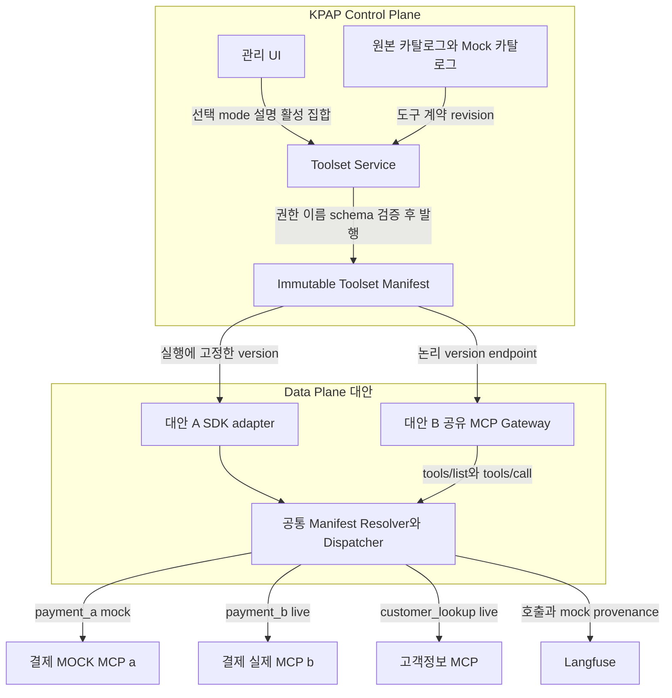
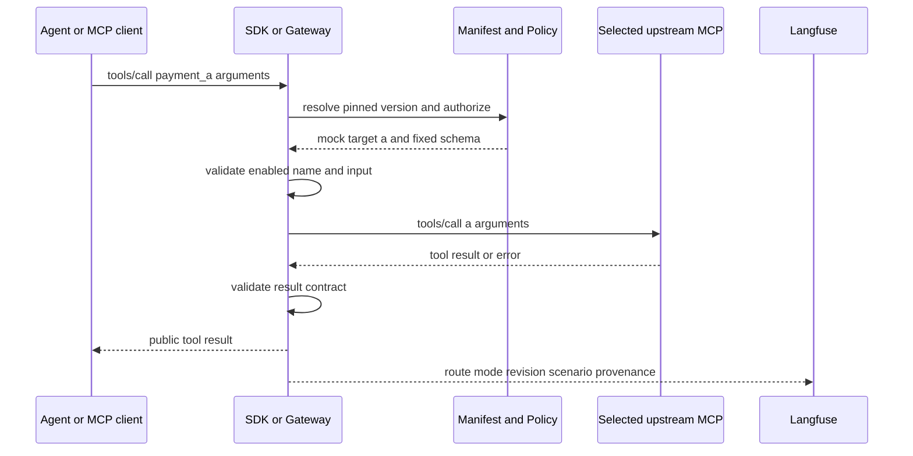

# 도구 번들링과 개별 Mock 전환 설계

설계 제안 v0.1 · 2026년 10월 25일

## 1. 현재 기능과 요구사항

현재 KPAP는 MCP 서버 단위로 도구를 카탈로그화한다. 예를 들어 결제서비스의 a·b·c·d API를 하나의 MCP 서버로 제공하며, 도구 설명과 도구 추가·삭제를 동적으로 관리할 수 있다. 별도 MOCK 카탈로그는 이 서버를 모킹하여 stub 데이터를 반환하는 endpoint를 제공한다. 이는 사용자가 설명한 현재 기능이며 배포 구현을 검증한 결과는 아니다.

에이전트 동적 제어의 우선순위는 다음과 같다.

1. 최우선: 개별 도구의 live/mock 전환.
2. 우선: 도구 설명 동적 변경.
3. 필요: 도구 동적 추가·제거.

검토 대상은 여러 카탈로그의 개별 도구를 선택하여 번들로 만들고 별도 endpoint로 제공하는 기능이다. 이 문서는 필요성과 구조·호출 흐름의 제안이며 SDK 집계 또는 Gateway 도입을 확정한 결정이나 구현 완료 선언이 아니다.

## 2. 권고안

**필요한 핵심은 번들별 물리 MCP 서버가 아니라, 도구별 실행 정책을 고정한 Toolset Manifest다.** 개별 mock 라우팅, 설명 overlay, 활성 도구 집합을 같은 버전으로 관리하고 endpoint는 이를 배포하는 선택적 채널로 분리한다.

카탈로그는 원본 도구를 소유하고, Toolset은 선택·설명·실행 대상에 대한 버전 있는 뷰를 제공한다. 번들 발행 때문에 원본 도구나 설명을 복제·변경하지 않는다.

| 대안 | 구성 | 적합한 조건 | 판단 |
|---|---|---|---|
| A SDK 집계 | SDK가 manifest를 읽어 모델 도구 정의와 dispatcher 구성 | KPAP SDK 에이전트만 사용 | 가장 작은 MVP 후보 |
| B 공유 MCP Gateway | 하나의 gateway가 여러 논리 버전 endpoint 제공 | 비SDK·다중 프레임워크·범용 MCP 클라이언트 지원 | 확장 목표 후보 |
| C 번들별 서버 배포 | 번들마다 프로세스·배포·endpoint 분리 | 전용 네트워크·credential·규제·성능 격리 요구 | 예외적으로 선택 |

A와 B는 같은 resolver·dispatcher를 공유하도록 설계할 수 있다. 그러나 두 경로를 동시에 출시할 필요는 없다. 클라이언트 범위와 운영 요구를 확인한 뒤 선택한다. endpoint가 다르다는 사실만으로 배포 격리나 보안 경계가 생기지는 않는다.

## 3. 결제 도구 번들 예시

기존 카탈로그는 다음과 같다.

```text
결제 실제 MCP       a, b, c, d
결제 MOCK MCP       a, b, c, d
고객정보 MCP        lookup_customer, ...
```

제안 Toolset `checkout-test@7`은 다음처럼 구성한다.

| 공개 이름 | 원본 도구 | 실행 대상 | 설명 |
|---|---|---|---|
| payment_a | 결제 a | 결제 MOCK endpoint의 a | Toolset 설명 override |
| payment_b | 결제 b | 결제 실제 endpoint의 b | 원본 설명 |
| customer_lookup | 고객정보 lookup_customer | 고객정보 실제 endpoint | Toolset 설명 override |

c·d는 포함하지 않으므로 노출·실행하지 않는다. 기존 MOCK endpoint가 서버 전체를 모킹해도 dispatcher가 a 호출만 그 endpoint로 보내면 개별 도구 전환이 가능하다. a 전용 mock 서버를 별도로 만들 필요는 없다.

전제는 실제 a와 mock a의 입력·출력 계약이 호환되고, mock endpoint가 해당 도구 호출을 지원한다는 것이다. mock fixture/scenario는 모델이 보내는 라우팅 argument가 아니라 승인된 실행 설정으로 선택한다.

## 4. 아키텍처



그림의 A·B는 대안이다. 공통 dispatcher는 논리 컴포넌트이며 반드시 독립 서비스로 배포해야 한다는 뜻이 아니다. Gateway를 선택하면 에이전트에 대해서는 MCP 서버, upstream 카탈로그에 대해서는 MCP 클라이언트가 된다.

### 책임 경계

- Control plane: 카탈로그 참조, Toolset 편집·발행, 권한·호환성 검증, 버전 관리.
- SDK 또는 Gateway: 요청의 신뢰된 identity와 고정 manifest 확인, 도구 목록 제공, 입력 검증, 라우팅, 결과 검증.
- 원본 MCP: 원본 도구 구현·자원 권한·실제 업무 수행.
- Mock MCP: 승인된 stub/scenario 실행. 실제 서비스 호출의 자동 대체 경로가 아님.
- Langfuse: 실행·mock 출처·입출력 관측. 설정 또는 권한의 원본 저장소가 아님.

MCP는 도구 discovery/invocation을 제공한다. 카탈로그 CRUD, 설명 overlay, live/mock 선택과 Toolset 발행은 KPAP 관리 계약이지 MCP 표준 관리 API가 아니다.

## 5. Toolset Manifest 제안

아래는 MCP 표준 필드가 아닌 KPAP 관리 스키마 예시다.

```json
{
  "toolsetId": "checkout-test",
  "version": 7,
  "tools": [
    {
      "exposedName": "payment_a",
      "source": {
        "catalogId": "payment",
        "toolName": "a",
        "contractRevision": "3"
      },
      "descriptionOverride": "승인된 입력으로 결제 a 기능을 요청합니다.",
      "inputSchemaHash": "sha256:...",
      "outputSchemaHash": "sha256:...",
      "route": {
        "mode": "mock",
        "targetCatalogId": "payment-mock",
        "targetToolName": "a",
        "targetRevision": "stub-v8",
        "scenarioRevision": "success-v2"
      }
    }
  ]
}
```

예시는 식별·라우팅 필드만 발췌했다. 발행 시 실제 input/output schema와 해석된 설명을 manifest에 포함하거나 immutable content reference로 보존한다. hash만 저장하고 실행 시 원본의 최신 설명·schema를 다시 읽어 tools/list를 만들면 버전 고정이 성립하지 않는다.

### 발행 규칙

1. tools에 포함된 항목만 활성화한다. 비활성 도구는 노출 목록과 dispatcher 모두에서 제외한다.
2. exposedName은 Toolset 안에서 고유하고 안정적이어야 한다. 원본 식별은 catalogId·toolName·revision으로 한다.
3. descriptionOverride 생략 시 원본 버전의 설명을 사용한다. 변경은 새 Toolset version으로 발행한다.
4. 실제 endpoint·credential은 서버 등록 정보로 해석한다. manifest에 비밀·임의 URL·실행 코드를 넣지 않는다.
5. live/mock 대상에 대한 현재 접근 권한과 schema 호환성을 검사한다.
6. description은 모델 행동에 영향을 주지만 실행 권한을 부여하지 않는다.
7. 모델 arguments로 mode·upstream URL·credential을 선택하지 않는다.
8. mock 실패·timeout·fixture 부재 시 실제 endpoint로 fallback하지 않는다.

MCP 도구 이름의 고유성은 서버 범위이므로 여러 서버를 합칠 때 충돌 처리가 필요하다. serverInfo.name을 전역 고유 catalog ID로 사용하지 않는다. [MCP Tools](https://modelcontextprotocol.io/specification/2026-07-28/server/tools)

## 6. 호출 플로우

### 6.1 실행 시작과 고정

1. 에이전트가 사용할 Toolset을 선택한다.
2. KPAP가 draft/alias를 특정 manifest version으로 해석한다.
3. 사용자·프로젝트가 각 live/mock 대상에 접근할 수 있는지 검사한다.
4. 실행 snapshot에 toolsetId/version/hash를 기록한다.
5. 모델에 노출하는 도구 정의와 실행 dispatcher가 같은 manifest를 사용한다.

Toolset 선택을 기존 승인 tools ID로 해석할지 새 typed 확장으로 전달할지는 별도 wire 계약에서 합의한다. 기존 A2A tools 배열에 manifest 객체를 조용히 삽입하지 않는다.

같은 task의 resume에서는 저장된 manifest를 복원한다. latest를 다시 해석하지 않는다. SDK가 모델을 compile 시점에만 bind했다면 runtime Toolset 변경이 자동 적용되지 않으므로 모델 호출 경계에서 확정된 tool schema를 바인딩해야 한다.

### 6.2 목록 조회

```text
Client tools/list
 → identity와 Toolset version 확인
 → manifest의 활성 도구 선택
 → 공개 이름과 설명 overlay 적용
 → 고정 inputSchema 및 지원되는 outputSchema 반환
```

Toolset의 실제 권한과 MCP 프로토콜에 맞게 paginated 목록을 제공한다. 이전 요청이 만든 연결 전역 상태에 따라 목록을 바꾸지 않는다. 설명·도구 집합 변경은 새 manifest를 쓰는 실행에 반영한다.

### 6.3 도구 실행



Gateway는 공개 이름을 manifest에 지정된 upstream tool 이름으로 변환한다. 같은 이름이 다른 카탈로그에도 있어도 임의 검색으로 대상을 선택하지 않는다. 실제 호출 직전 현재 권한을 재검사한다.

outputSchema를 선언한 경우 structured result가 그 계약을 만족해야 한다. 실제·mock 계약이 다르면 명시적으로 버전 관리한 adapter를 사용하거나 발행을 거부한다. 업무 도구의 error 결과와 protocol/transport 오류도 구분한다. [MCP Tools](https://modelcontextprotocol.io/specification/2026-07-28/server/tools)

### 6.4 변경과 기존 실행

| 변경 | 적용 시점 | 기존 실행 |
|---|---|---|
| 개별 live/mock 전환 | 새 version으로 시작하는 다음 실행 | 기존 route 유지 |
| 설명 overlay | 다음 실행의 모델 도구 정의 | 기존 설명 유지 |
| 도구 추가·제거 | 다음 실행의 목록·dispatcher | 기존 집합 유지 |
| 보안상 권한 철회 | 실제 호출 시 즉시 차단 가능 | snapshot과 무관하게 차단 |
| 원본 도구 소실·계약 불일치 | 감지 시 오류 | 다른 도구로 조용히 대체 금지 |

설정 고정은 권한 고정이 아니다. 고정 snapshot이 권한 철회를 무시하는 허가증이 되어서는 안 된다.

## 7. Endpoint와 MCP 버전

Gateway를 선택하면 논리 endpoint를 다음처럼 제공할 수 있다.

```text
/mcp/toolsets/checkout-test/versions/7
/mcp/toolsets/checkout-test/versions/8
```

이는 KPAP 제안 경로다. 하나의 gateway deployment가 모두 처리할 수 있다. latest alias는 실행 시작의 편의를 위한 선택값으로 두고 실제 목록·호출에는 특정 version을 사용한다.

2026-10-25 확인한 공식 MCP 규격 2026-07-28은 이전 규격과 transport·알림 방식이 다르다. 최신 Streamable HTTP는 protocol session과 GET stream endpoint를 제거하고 request-scoped POST를 사용한다. 기존 배포가 2025-11-25라면 해당 adapter를 유지한다. 실제 배포가 최신 규격을 지원한다고 가정하거나 업그레이드를 이번 기능의 전제로 강제하지 않는다. [최신 Streamable HTTP](https://modelcontextprotocol.io/specification/2026-07-28/basic/transports/streamable-http), [2025-11-25 Transports](https://modelcontextprotocol.io/specification/2025-11-25/basic/transports)

등록 정보에는 endpoint, 지원·협상 protocol version, transport adapter, credential reference, tool contract revision을 둔다. 요청별 protocol 필드·초기화·알림·재연결은 해당 adapter가 구현한다.

tools/list_changed는 재조회 신호이지 immutable snapshot이나 모델의 즉시 재바인딩 보장이 아니다. 최신 규격의 구독 절차와 이전 버전 알림 절차를 혼용하지 않는다. 목록 pagination과 TTL cache도 원본 구현의 불변성을 보장하지 않는다. [MCP Caching](https://modelcontextprotocol.io/specification/2026-07-28/server/utilities/caching)

## 8. 보안과 관측

### 같은 manifest로 노출과 실행

목록은 version 7인데 호출은 version 8로 처리하는 혼합을 금지한다. cache key는 tenant·인증 주체·권한 컨텍스트(scope 포함)·Toolset version·protocol version을 구분한다. 권한 변경이 목록·실행 허용 결과에 반영되도록 cache를 무효화하거나 실행 시 재검증한다.

### token과 endpoint

클라이언트 token을 upstream에 그대로 전달하지 않는다. Gateway용 token audience를 검증하고 upstream별 credential 또는 승인된 위임 정책을 사용한다. 등록 origin·redirect·내부망 접근에 SSRF 방어를 적용한다. [MCP Authorization](https://modelcontextprotocol.io/specification/2026-07-28/basic/authorization), [MCP Security Best Practices](https://modelcontextprotocol.io/docs/2026-07-28/tutorials/security/security_best_practices)

### Mock 출처

다음을 run/node/invocation/toolCall에 연결한다.

```text
Toolset ID / version / manifest hash
exposedName / source catalog / source tool
routeMode / target revision / mock scenario revision
resolved description hash / schema hash / attempt ID
```

UI와 평가 리포트에는 실제 호출의 MOCK 여부를 표시한다. live 도구가 섞인 Toolset은 mixed이며 전체 MOCK 실행으로 표시하지 않는다. SDK 관리 경로 밖의 custom·직접 API 호출까지 mock으로 전환되었다고 보장하지 않는다. provenance를 위해 업무 structuredContent에 임의 필드를 넣어 outputSchema를 깨뜨리지 않는다. 필요한 운영 metadata와 모델에게 전달할 안내는 별도 정책으로 관리한다.

### 재현성 한계

manifest를 고정해도 upstream이 동일 endpoint의 실제 구현이나 데이터를 바꾸면 완전한 재현성이 보장되지 않는다. 가능한 경우 upstream revision/버전 endpoint까지 고정하고, 확인된 schema·revision drift는 실패 처리한다. pin이 불가능한 live 대상은 그 한계를 표시한다. snapshot hash만으로 원격 구현이 보존되었다고 주장하지 않는다.

## 9. 출시 범위와 인수 기준

MVP 후보는 기존 mock catalog를 재사용하는 per-tool routing, description overlay, 활성 목록, 불변 manifest, SDK 또는 gateway dispatcher, mock provenance다. 비SDK 클라이언트 수요가 확인되면 공유 gateway endpoint를 제공한다. 전용 배포는 별도 격리 요구가 확인될 때 선택한다.

인수 기준은 다음과 같다.

- 같은 Toolset에서 payment_a는 mock, payment_b는 live, 고객정보 도구는 다른 카탈로그로 호출된다.
- 설명 변경은 원본 카탈로그를 변경하지 않고 선택한 version에만 적용된다.
- 제외된 도구는 모델 노출뿐 아니라 dispatcher에서도 실행되지 않는다.
- mock 장애가 live 부작용으로 이어지지 않는다.
- 동시 실행의 route·설명·도구 집합이 섞이지 않는다.
- resume는 같은 manifest를 복원하되 현재 권한 철회는 반영한다.
- 이름 충돌·schema 불일치·미지원 protocol은 명시적으로 거부한다.
- 실제 upstream 호출과 mock scenario revision을 관측으로 확인할 수 있다.

이 설계는 기존 SDK 실행 snapshot 계약에 도구 세트의 세부 구성을 연결하는 확장이다. 물리 서버 생성 기능을 먼저 만들기보다 동일 manifest로 목록과 호출을 제어하는 경계를 먼저 검증한다.

## 관련 문서와 검증 범위

[SDK 실행 아키텍처](13-sdk-runtime-architecture.md)의 노드별 설정·snapshot·재개 계약을 사용한다. [SDK endpoint 계약](11-sdk-endpoint-contracts.md)은 새 Toolset wire 계약이 합의되기 전까지 자동 변경하지 않는다.

이 문서는 설계 제안이다. 실제 MCP 서버·Gateway·SDK 통합 테스트와 운영 배포는 수행하지 않았다. 별도 runtime 코드나 프로토타입 변경을 포함하지 않는다.
